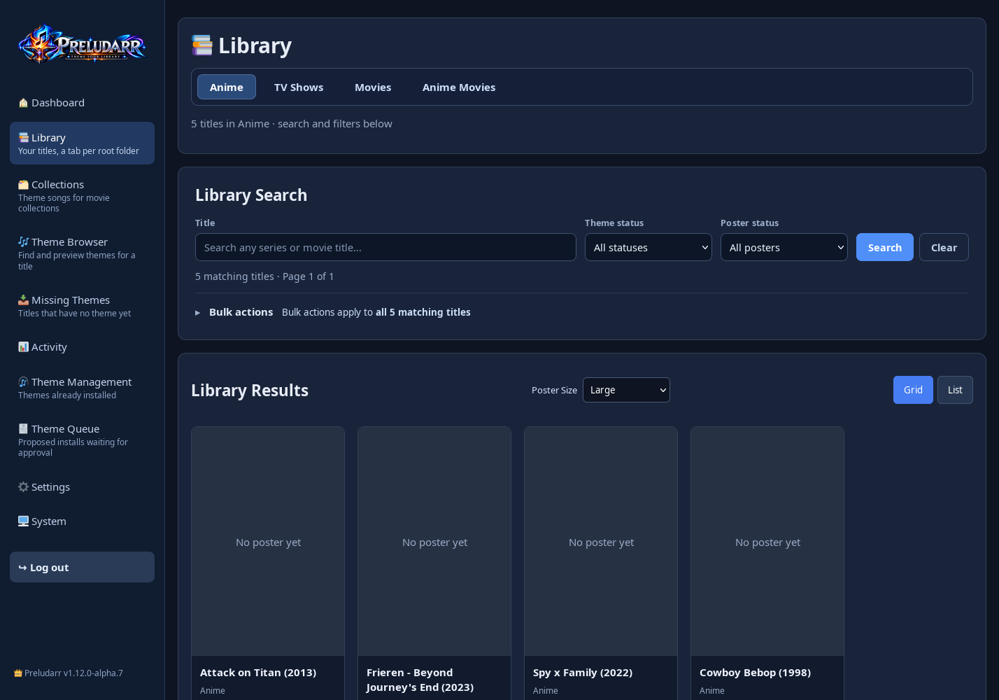
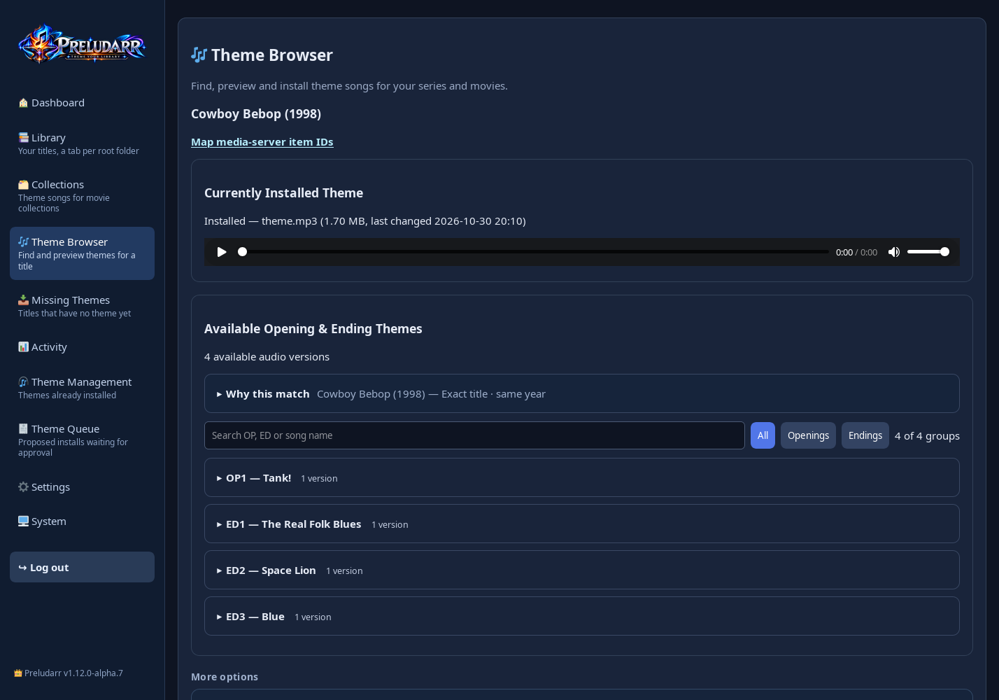
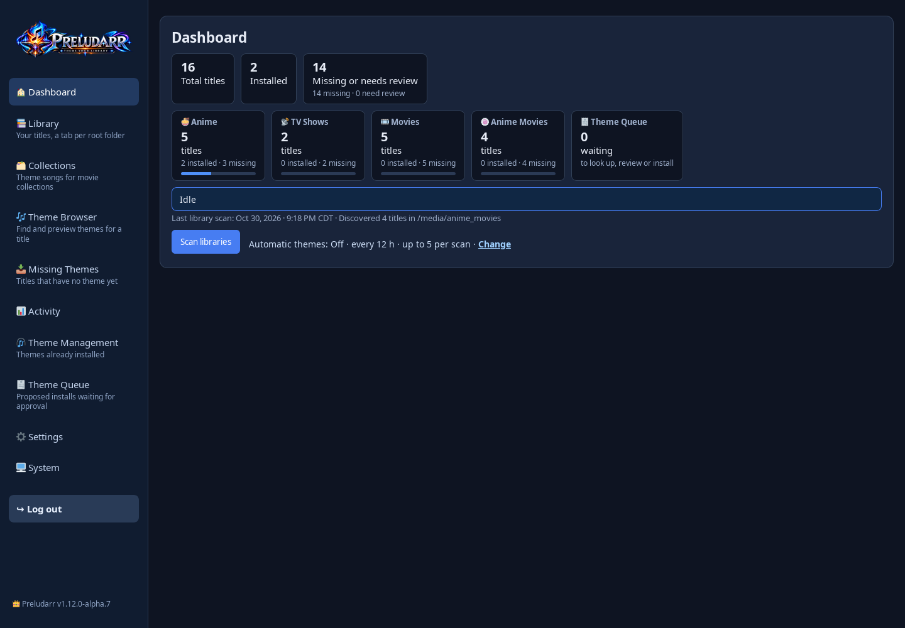
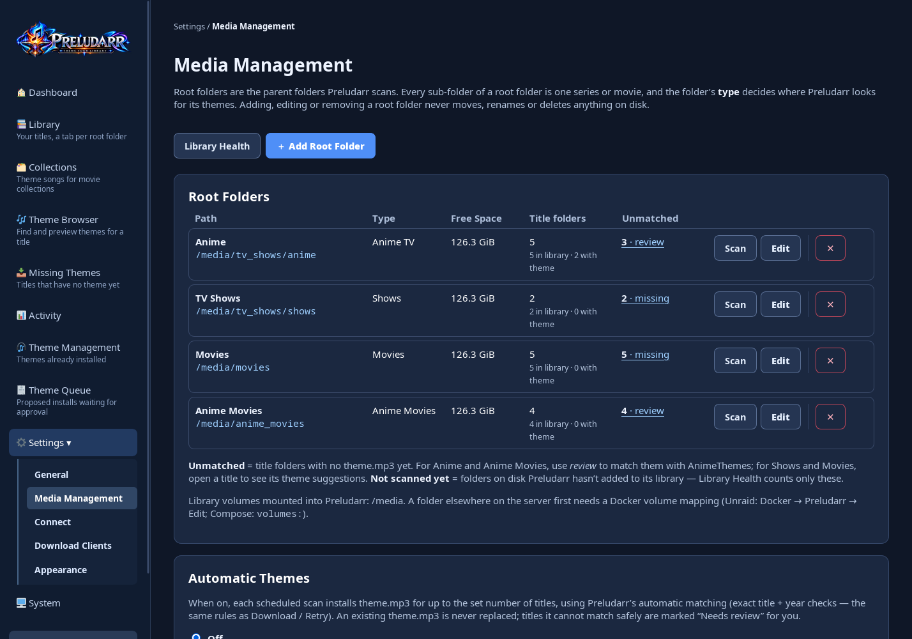
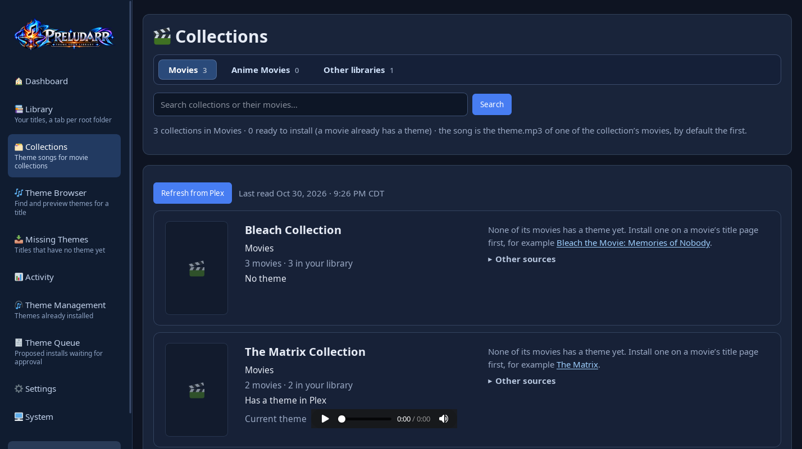
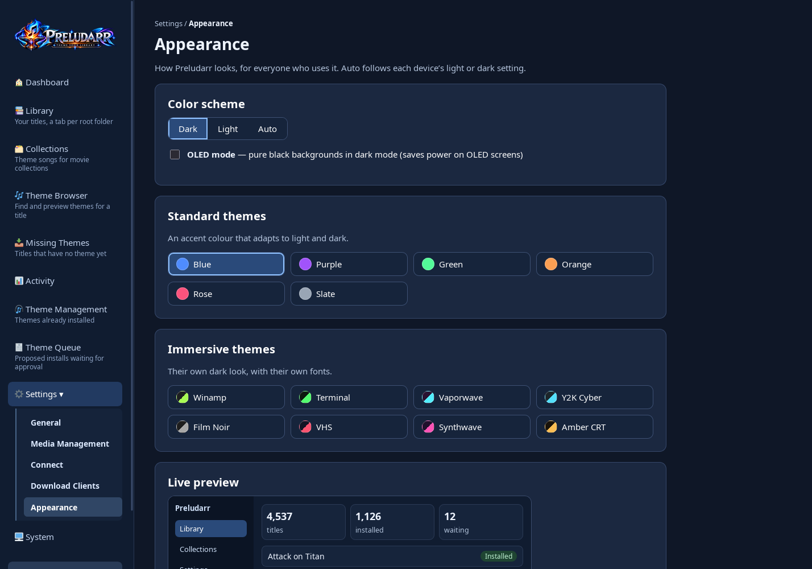

<p align="center">
  
</p>

<p align="center"><strong>THEME YOUR LIBRARY</strong></p>

# Preludarr

**Theme songs for your media library.** Preludarr finds the opening or theme song of each anime, TV show and movie in your library and saves it as `theme.mp3` in the title's folder, where Plex, Jellyfin and Emby play it.

   

> **Status: stable.** `1.12.0` is the first stable release: `ghcr.io/shedman214/preludarr:latest`. Make a backup (System → Backup & Restore) before each update.

| Library | Theme review |
|---|---|
|  |  |
| **Dashboard** | **Settings → Media Management** |
|  |  |
| **Collections** | **Settings → Appearance** |
|  |  |

<sub>Screenshots from a demo library of empty folders and a test Plex server; no real media or posters.</sub>

## Features

**Available in 1.12 (beta)**
- **Anime TV and anime movies:** openings and endings from [AnimeThemes](https://animethemes.moe), matched by title and year through AniList and the AniDB title list. Preview every version, then install the one you choose.
- **TV shows and movies:** suggestions from Plex TV Themes and ThemerrDB. Optional YouTube search (your own API key and cookies; preview only until you install). For shows and movies it looks on the [MainThemeSoundtracks](https://www.youtube.com/@mainthemesoundtracks) channel first, which costs none of your daily searches, then searches all of YouTube.
- **Library:** a tab per root folder, search and filters, a Theme Queue for reviewing many titles at once, automatic installs for anime (off by default), and Library Health (folders Preludarr cannot write to, extra theme files).
- **Connect (optional):** Sonarr, Radarr, Plex, Jellyfin and Emby, to match titles by their ids and refresh the media server after an install.
- **Sign in with Plex:** connect Plex without copying a token. Sign in in Plex's own window, approve Preludarr, and pick your server (local address first). Several Plex servers can be connected; one is the main server (title links, refresh after installs), and every server gets its own Collections tab. Your Plex account token is used only to list your servers and is never saved.
- **Jellyfin Quick Connect:** enter your Jellyfin address, then approve the code Preludarr shows in Jellyfin (profile → Quick Connect, as an administrator). Quick Connect must be turned on in Jellyfin (Dashboard → General).
- **Sign in to Emby:** enter your Emby address, username and password once. The password goes only to your Emby server and is not saved; Preludarr keeps the access token Emby returns.
- **Collections:** a theme for each movie collection, using the theme of one of its movies (the first movie by default). Instead of a movie's theme you can also use a YouTube link, your own audio file (with manual installs on), or Smart YouTube search suggestions (your API key; preview first, you choose). The Collections page has a tab per movie root folder, like the Library, and shows only collections from your root folders (others sit under "Other libraries"). A search bar finds collections by their name or their movies' names. Collections show their own artwork from Plex, Jellyfin or Emby. Plex: uploaded to the collection, and removable. Jellyfin and Emby: **experimental**, written into the server's own collection folder, which you map into Preludarr; those servers do not officially support collection themes, so some apps may not play them.
- **Backups:** manual and scheduled backups of the database and settings, and a guarded restore with automatic rollback.
- **Appearance:** Settings → Appearance — Dark, Light or Auto (follows each device), OLED mode, six accent colours and eight immersive themes (Winamp, Terminal, Vaporwave, Y2K Cyber, Film Noir, VHS, Synthwave, Amber CRT), with a live preview. Text stays readable (WCAG AA contrast) in every theme.
- **Safety:** first-run account setup, sign-in on every page, protection against cross-site requests, a read-only API key by default, and a container that runs as a normal user.

**Beta limitations**
- Posters for shows and movies need your own TMDB (or TheTVDB) API key.
- YouTube search needs your own YouTube Data API key and a cookies.txt file, and has a daily quota.
- One user account. There are no separate users or roles.
- Tested mainly on Unraid with Plex. Jellyfin and Emby connections are less tested.
- Images are planned for amd64 and arm64. The arm64 build has not been tested on real ARM hardware yet.

## Install

### Docker Compose
```yaml
services:
  preludarr:
    image: ghcr.io/shedman214/preludarr:latest
    container_name: preludarr
    restart: unless-stopped
    ports:
      - "8788:8787"            # open http://<server-ip>:8788
    environment:
      - PUID=1000              # user and group that own your media (`id youruser`)
      - PGID=1000
      - TZ=America/Chicago     # your time zone: https://en.wikipedia.org/wiki/List_of_tz_database_time_zones
    volumes:
      - ./preludarr-config:/config            # settings, database, backups
      - /path/to/tv:/media/tv_shows           # your libraries; read/write so theme.mp3 can be saved
      - /path/to/movies:/media/movies
```
Then run `docker compose up -d`.

### docker run
```sh
docker run -d --name preludarr --restart unless-stopped \
  -p 8788:8787 -e PUID=1000 -e PGID=1000 -e TZ=America/Chicago \
  -v /path/to/preludarr-config:/config \
  -v /path/to/tv:/media/tv_shows \
  -v /path/to/movies:/media/movies \
  ghcr.io/shedman214/preludarr:latest
```

### Unraid
Preludarr is on its way to Community Applications. Until it is listed there, add it from the template:
1. Open the Unraid terminal and run:
   ```sh
   wget -O /boot/config/plugins/dockerMan/templates-user/my-Preludarr.xml \
     https://raw.githubusercontent.com/shedman214/preludarr/main/templates/my-preludarr.xml
   ```
2. Docker → **Add Container** → Template: **Preludarr**.
3. Set **TV shows** and **Movies** to your shares (for example `/mnt/user/tv` and `/mnt/user/movies`), keep **PUID 99 / PGID 100**, and click **Apply**.

### Image tags
| Tag | Contents |
|---|---|
| `latest` | The newest stable release. **Recommended.** |
| `1.12`, `1.12.0`, … | A release line or one exact version. Use it to stay on a version or to go back. |
| `beta` | The newest beta, or the newest stable release if that is newer. A beta never changes `latest`. |

### Build it yourself
```sh
git clone https://github.com/shedman214/preludarr.git
cd preludarr
docker build -t preludarr:local .
```
Then use `preludarr:local` as the image in the examples above.

## First start
1. Open the container log (Unraid: Docker → Preludarr → Logs; elsewhere `docker logs preludarr`). It shows a **setup code** such as `K7QM-3XRP`.
2. Open `http://<server-ip>:8788`, enter the code, and create your account (password: 16 characters or more).
3. Go to **Settings → Media Management** and add your library folders as root folders. Choose a type for each: Anime TV, Anime Movies, Shows or Movies.
4. Preludarr scans them. Open a title to review its themes, use the **Theme Queue** for many titles, or choose **Automatic Themes** (Settings → Media Management) to install anime themes automatically.

The setup code changes every time the container restarts, and it is only ever shown in the log.

## What Preludarr changes on disk

**Inside `/config` (Preludarr's own data):** the database, settings files, logs, poster cache, backups (`system_backups/`), the theme recycle bin (`theme-trash/`) and the YouTube cookies file. On first start Preludarr changes the owner of `/config` and everything in it to `PUID:PGID`.

**Inside your library folders**, only these actions write anything, and only in title folders under the root folders you added:

| Action | What it changes |
|---|---|
| **Install a theme** (Theme Browser, Theme Queue, Automatic Themes, custom upload, YouTube) | Writes `theme.mp3` in the title folder. The file is prepared under a temporary hidden name in the same folder, then put in place in one step. It gets owner `PUID:PGID` and mode `664`. Automatic Themes and the Theme Queue never replace an existing `theme.mp3`. |
| **Replace a theme** (you confirm "replace" in the Theme Browser, custom upload or YouTube) | The existing `theme.mp3` is first copied into the recycle bin in `/config/theme-trash` (checked by fingerprint), then replaced. **Undo** in the recycle bin puts it back. If the copy cannot be made, nothing is replaced. |
| **Remove** (Theme Management) | Moves `theme.mp3` into a hidden `.themearr-recovery` folder inside the same title folder. |
| **Restore** (Theme Management) | Moves a file from `.themearr-recovery` back to `theme.mp3`. |
| **Extra theme files** (Library Health → review) | Moves the extra theme files you do not keep into the recycle bin in `/config/theme-trash`; Undo puts them back. |
| **Permissions** (Settings → Media Management, off by default) | When on: sets the chosen mode and owner on each `theme.mp3` Preludarr installs. The one-time **Fix existing theme.mp3 files** tool changes only the mode and owner of `theme.mp3` files in title folders, after a preview, and writes an undo list to `/config/logs`. |
| **Collections** | Plex: uploads the chosen movie's `theme.mp3` to the collection in Plex (nothing is written on disk); Remove deletes it from Plex again. Jellyfin/Emby (experimental): writes `theme.mp3` into the collection's folder in the server's config, which you map into Preludarr; a previous file there is copied to `/config/collection_theme_backups` first, and Remove puts it back. |
| **Root folders** (add, edit, move, remove) | Change only Preludarr's database. Nothing on disk is moved, renamed or deleted. |
| **Restore a backup** | Replaces Preludarr's database and settings in `/config` on the next start, after saving a safety copy. Media folders are not touched. |

Preludarr never deletes or renames videos or other media files.

## Settings (environment variables)
Most settings live in the web interface. These optional variables are read at start-up:

| Variable | Default | Meaning |
|---|---|---|
| `PUID`, `PGID` | `1000` | User and group Preludarr runs as. Use the owner of your media (Unraid: `99` and `100`). On first start Preludarr gives its `/config` folder to this user; media folders are not changed. `PUID=0` runs as root (not recommended). |
| `UMASK` | `002` | Permissions for new files and folders. |
| `TZ` | UTC | Time zone for schedules and times shown, for example `America/Chicago` or `Europe/London`. Use a name from the **TZ identifier** column of the [list of time zones](https://en.wikipedia.org/wiki/List_of_tz_database_time_zones). Unraid sets this for you. |
| `PRELUDARR_LIBRARY_MOUNTS` | `/media` | Comma-separated folders the folder picker may browse. |
| `AUTO_DOWNLOAD`, `SCAN_INTERVAL_HOURS`, `MAX_DOWNLOADS_PER_SCAN` | `false`, `12`, `5` | Starting values for Automatic Themes (on/off, hours between scans, installs per scan). After the first start, change them in Settings → Media Management. |
| `TMDB_API_KEY` | – | Your own [TMDB](https://www.themoviedb.org/settings/api) key, for movie and show posters and ids. Can also be set in Settings → Connect. |
| `TVDB_API_KEY`, `TVDB_SUBSCRIBER_PIN` | – | Your own TheTVDB key (optional). |
| `POSTER_BACKGROUND_ENABLED` | `false` | `true`: fetch missing posters in the background. |
| `PRELUDARR_EXTRA_ALLOWED_HOSTS` | – | Host names you open Preludarr by, e.g. `preludarr.lan:8788`. Private IP addresses always work. Also in Settings → General. |
| `PRELUDARR_PUBLIC_URL` | – | The HTTPS address when you use a reverse proxy or tunnel. Also in Settings → General. |
| `PRELUDARR_MANUAL_INSTALL_ENABLED` | `0` | `1`: allow installing your own uploaded audio and YouTube links. |
| `PRELUDARR_UPDATE_CHECK` | on | `0`: never check GitHub for new versions. |
| `PRELUDARR_HTTP_MAX_CONNECTIONS`, `PRELUDARR_HTTP_MAX_PER_CLIENT` | `64`, `16` | Most requests handled at once, overall and per client address. |

Older `THEMEARR_*` and `SPLICARR_*` names of the `PRELUDARR_*` settings still work.

## API
`GET /api/v1/status` and `GET /api/v1/activity` with the key from Settings → General in the `X-Api-Key` header. `POST /api/v1/command/scan` starts a library scan (at most once every 5 minutes) **only if** you allow it under Settings → General → API key & security. Requests are limited to 60 per minute.

**Since 1.12 a new install's API key is read-only.** An install from before 1.12 keeps the behaviour it had (the key may start scans), and that choice is saved once so it appears in Settings; a choice you saved yourself is never changed.

## Backups and updates
- **System → Backup & Restore** makes backups of the database and settings (manual, or automatic on a schedule). They are stored in `/config/system_backups` and contain your saved API keys and tokens, so keep downloads private.
- **Restore:** verify a backup, confirm, then restart the container. Preludarr keeps a safety copy of your current data and puts it back automatically if the restore fails.
- **Update:** make a backup, then pull the new image (or change the tag) and restart. Preludarr never updates itself; System → Releases shows when a new version is out.
- **Go back:** use the previous version's tag. If the newer version changed your data, restore the backup you made first.

## Security
- Every page needs your sign-in. Forms are protected against cross-site requests. The API key is accepted only in a header, and is read-only unless you allow scans.
- The web server limits slow and oversized requests and how many connections it handles at once.
- Do not open the port directly to the internet. For remote access, use a reverse proxy or tunnel with HTTPS and set the public address in Settings → General.
- Report vulnerabilities privately, as described in [SECURITY.md](SECURITY.md). **Do not use public Issues for security problems.**

Preludarr has not had an independent security audit.

## Contributing
See [CONTRIBUTING.md](CONTRIBUTING.md). Bug reports: use the issue form and remove passwords, API keys, tokens and private paths first.

## Credits and licence
Preludarr uses data from AnimeThemes, AniList, AniDB, TMDB, TheTVDB, Plex TV Themes, ThemerrDB and, optionally, YouTube. *This product uses the TMDB API but is not endorsed or certified by TMDB.* Preludarr is not affiliated with any of these services. Finding a song through a source does not mean you are allowed to download it; download only what you have the right to use.

Preludarr was previously named Splicarr, and before that Themearr.

Preludarr is free software: GNU General Public License, version 3 or later (GPL-3.0-or-later), with no warranty. See [LICENSE](LICENSE), [NOTICE.md](NOTICE.md) and [docker/THIRD_PARTY_PACKAGES.txt](docker/THIRD_PARTY_PACKAGES.txt).
